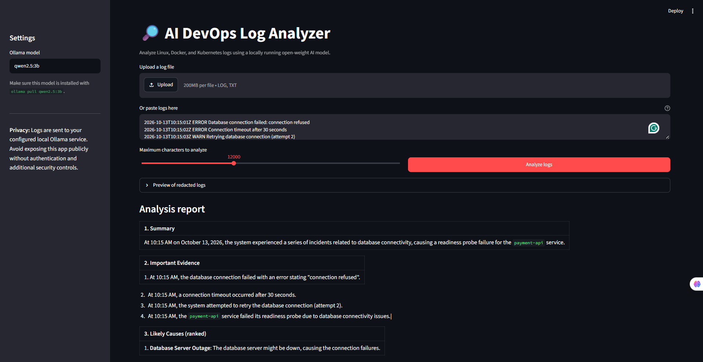

# AI DevOps Log Analyzer

A local-first Streamlit application that uses an open-weight model served by Ollama to analyze Linux, Docker, and Kubernetes logs.



## Features

- Paste logs or upload `.log` / `.txt` files
- Basic best-effort secret redaction
- Local model inference through Ollama
- Evidence-based troubleshooting report
- Download the report as Markdown
- Sample logs for a quick demo

## Requirements

- Python 3.10+
- Ollama installed and running
- A model compatible with Ollama (default: `qwen2.5:3b`)

## Run locally

```bash
ollama pull qwen2.5:3b
python -m venv .venv
# Windows PowerShell:
.venv\Scripts\Activate.ps1
# macOS/Linux:
source .venv/bin/activate
pip install -r requirements.txt
streamlit run app.py
```

Open the local URL printed by Streamlit, usually http://localhost:8501.

## Docker (application only)

Build the image:

```bash
docker build -t ai-devops-log-analyzer .
```

The container must be able to reach the Ollama API. On Docker Desktop for Windows/macOS, use `http://host.docker.internal:11434` as the Ollama host. On Linux, configure a reachable host address or a shared Docker network. Update `OLLAMA_URL` in `log_analyzer.py` accordingly; do not expose Ollama publicly.

Run the app:

```bash
docker run --rm -p 8501:8501 ai-devops-log-analyzer
```

## Security notes

- Redaction is best-effort and cannot guarantee every secret is removed.
- Review logs before analysis. Do not paste credentials, private keys, customer data, or production secrets.
- Keep Ollama bound to a trusted interface; do not expose it to the public internet.
- Treat model output as a suggestion, not an authoritative diagnosis. Validate commands before running them.
- Do not run suggested commands automatically.

## Limitations

- The model may hallucinate or misdiagnose incidents.
- Large log files are truncated to a configurable character limit.
- The initial version does not parse every log format or automatically query a live cluster.
- Open-weight model licenses vary; verify the selected model's terms for your use case.

## Hacktoberfest demo checklist

1. Start Ollama and ensure the model is downloaded.
2. Launch the Streamlit app.
3. Analyze `sample_logs.txt`.
4. Capture a screenshot or short screen recording.
5. Ask a DevOps engineer to test it on sanitized logs and record honest feedback.
